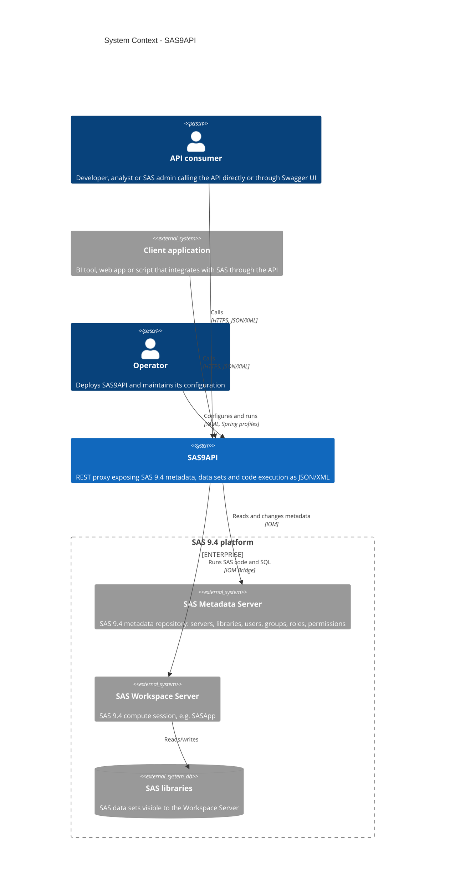

# Level 1 – System Context

SAS9API (`sas-proxy`) is a REST proxy in front of a SAS 9.4 platform. It turns SAS metadata, SAS data sets and SAS code execution into HTTP endpoints that return JSON or XML. That lets tools that can't speak SAS IOM work with SAS directly.

## Elements

| Element | Type | Description |
|---|---|---|
| API consumer | Person | Calls the `/sas/**` endpoints directly or through the bundled Swagger UI. Administrators use the same API for metadata work: users, groups, roles, permissions, and copying, moving or deleting objects. |
| Client application | External system | Any HTTP client that integrates with SAS through SAS9API instead of the SAS Java client libraries. |
| Operator | Person | Builds and deploys `sas-proxy.jar`. Maintains the list of SAS Metadata Servers, the service-account credentials and the auth settings in `application.yml` and Spring profiles. |
| SAS9API | Software system (in scope) | Spring Boot application described in the [container](02-container.md) and component views. |
| SAS Metadata Server | External system | Configured per environment under `proxy.servers` (host, port and users). Every request opens a metadata session. It is also used to find the Workspace Server host and port, and to check Basic-auth credentials. |
| SAS Workspace Server | External system | Found through metadata (default `proxy.default_workspace_server_name: SASApp`) unless the caller passes `serverUrl`/`serverPort`. Runs submitted SAS code and serves SQL through its IOM data service. |
| SAS libraries | External data | Libraries and data sets the Workspace Server can reach. SAS9API reads them through `SASHELP` dictionary views and can query, insert, update and delete rows. |

## Notes

* SAS9API calls the SAS servers using the credentials of a **configured service account**, or the Basic-auth user when Basic auth is on. See [Risks](04-risks.md).
* Stored Process Servers are only **looked up** in metadata (`/sas/stp`). SAS9API never connects to them, so they are not shown.
