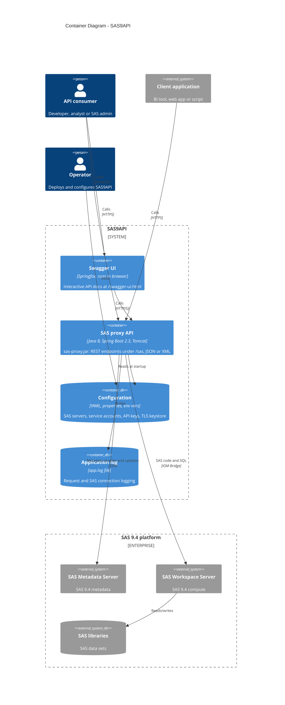

# Level 2 – Containers

SAS9API is deployed as **one Spring Boot process** (`sas-proxy.jar`). It also serves a browser-based Swagger UI, reads its configuration from files and environment variables, and writes a log file. All SAS work goes to the external SAS 9.4 servers.

## Elements

| Container | Technology | Responsibilities |
|---|---|---|
| SAS proxy API | Java 8, Spring Boot 2.3.8, embedded Tomcat, SAS 9.4 client JARs (`jars/`) | Serves the REST API under `/sas` (about 40 endpoints, JSON by default, XML on request). It listens on HTTPS `:8080`, and HTTP on `:8082` redirects to HTTPS. Each request opens its own SAS metadata and/or workspace session and closes it when done. Components: [03a](03a-components-request-handling.md) and [03b](03b-components-sas-connectivity.md). |
| Swagger UI | Springfox (`springfox-swagger2` 3.0.0, `springfox-swagger-ui` 2.10.5), Swagger 2 spec | API docs and a "try it out" console, served by the API process and run in the browser. Requests go to the host in `swagger.host`. |
| Configuration | `config/application.yml`, `src/main/resources/application.properties`, Spring profiles, environment variables | `proxy.servers[]` (Metadata Server host, port and users with password and API key), `proxy.apikeyEnabled` / `basicAuthEnabled`, `proxy.default_workspace_server_name`, `datasetdata.*` fetch limits, and `server.ssl.*` (PKCS12 keystore bundled on the classpath). |
| Application log | Spring Boot file logging (`logging.file.name: app.log`) | DEBUG logging for `com.sas` and `com.codexsoft.sas` by default. |

## Notes

* **Stateless by design, apart from one exception.** No database is used. Basic-auth credentials are, however, written to a shared singleton. See [Risks](04-risks.md#r2-basic-auth-credentials-leak-across-requests).
* **Two hops to reach data.** Data endpoints first ask the Metadata Server where the Workspace Server is, then open an IOM Bridge session to it. SQL runs over that session's data service using SAS's `MVAConnection` JDBC driver. No separate database server is involved.
* **Build:** `.github/workflows/build.yml` installs the SAS JARs into the local Maven repository and runs `mvn package`, producing the `sas-proxy.jar` artifact.
