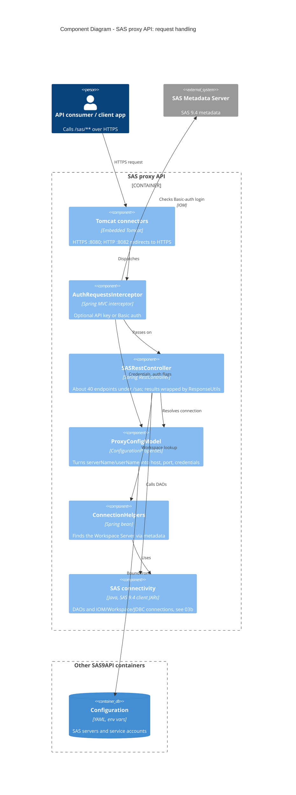

# Level 3 – Components: request handling

How a request travels through the **SAS proxy API** container before any SAS work happens: transport, authentication, choosing a connection, the controller, and the response envelope. Everything below the controller is grouped as *SAS connectivity* and drawn in [03b](03b-components-sas-connectivity.md). `ResponseUtils` is left out of the drawing to keep it readable; it is listed in the table below.

## Components

| Component | Source | Responsibilities |
|---|---|---|
| Tomcat connectors | `SasProxyApplication#servletContainer` | HTTPS connector on `server.port` (8080) using the PKCS12 keystore, plus an HTTP connector on `server.port.http` (8082). A `CONFIDENTIAL` security constraint on `/*` redirects HTTP to HTTPS. |
| AuthRequestsInterceptor | `secure/AuthRequestsInterceptor`, registered in `config/SpringConfig` | Runs on every request. If `apikeyEnabled` is on, the `apiKey` header is compared with the configured user's key. If `basicAuthEnabled` is on, the `Authorization: Basic` credentials are checked by opening a Metadata Server session; on success they **replace** the connection credentials held in `ProxyConfigModel`. When both flags are off (the default), every request is let through. |
| SASRestController | `controllers/SASRestController` | The only REST controller. Endpoint groups: `/sas` (connection info and repositories), `/servers` and `/stp` (server lookup), `/libraries` and `/servers/{s}/libraries` (list, create, delete), `.../datasets` and `.../data` (columns and rows: GET, PUT, POST, DELETE), `/cmd` (submit SAS code), and `/meta/*` (users, groups, roles, permissions, search, object copy/move/delete). Each handler opens a connection in try-with-resources, calls DAOs and returns through `ResponseUtils`. |
| ProxyConfigModel | `config/models/ProxyConfigModel` | Bound from `proxy.*`. Picks the server from the `serverName` query parameter and the user from `userName`, defaulting to the first of each, and returns `ConnectionProperties` (host, port, user, password, key, auth flags). |
| ConnectionHelpers | `connections/ConnectionHelpers` | Uses `RepositoriesDao` and `ServersDao` to look up a Workspace Server's host and port in metadata (default `SASApp`), or uses the caller's `serverUrl`/`serverPort`. Creates `JDBCConnection` objects. |
| ResponseUtils | `utils/ResponseUtils`, `models/APIResponse` | Runs the handler lambda and maps results and exceptions to a common `APIResponse` envelope and HTTP status. JSON by default; XML via content negotiation (`SpringConfig`). |
| SAS connectivity | `connections/**`, `parsers/**` | See [03b](03b-components-sas-connectivity.md). |

## Present in the code but inactive

These are left off the diagram because they don't run in the current build. They are listed so reviewers don't wonder where they went:

| Class | Status |
|---|---|
| `secure/aop/CheckDebug` | `@Aspect` whose `@Before` pointcut is commented out. If re-enabled, it would call `System.exit(0)` whenever the JVM has debug arguments. |
| `secure/sas/DateChecker`, `secure/sas/SiteNumberChecker` | Licence checks (SAS date and site number via the Workspace Server, site number via metadata `setinit`). Not referenced anywhere. |
| `config/LicenseCondition`, `res/Res1-3` | `LicenseCondition` always returns `true`, so the `/res1`–`/res3` placeholder controllers always load. They return `null`. |
| `/sas/license` endpoint | Commented out in `SASRestController`. |
