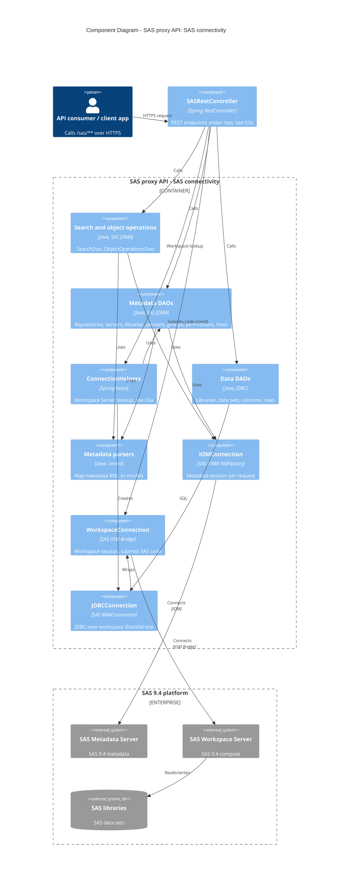

# Level 3 – Components: SAS connectivity

The part of the **SAS proxy API** container that talks to SAS. There are two paths:

* **Metadata path:** DAOs that use the SAS Java metadata API (JOMA) over an `IOMConnection`.
* **Data and compute path:** an IOM Bridge `WorkspaceConnection`, with an `MVAConnection` JDBC driver on top for SQL.

`SASRestController` and `ConnectionHelpers` are the same components as in [03a](03a-components-request-handling.md). `ConnectionHelpers` is drawn inside this boundary because it lives in the `connections` package and creates connections. `SearchDao` and `ObjectOperationsDao` share one box to keep the diagram readable.

## Components

| Component | Source | Responsibilities |
|---|---|---|
| Metadata DAOs | `connections/iom/dao/*`: `RepositoriesDao`, `ServersDao`, `LibraryMetadataDao`, `PersonsDao`, `IdentityGroupsDao`, `PermissionsDao`, `TreesDao` | Read metadata (repositories, Workspace and Stored Process servers, users, groups, roles, permissions, folder trees). `LibraryMetadataDao` also **creates and deletes** library definitions. |
| Search and object operations | `connections/iom/search/**`, `connections/iom/operations/*` | `SearchDao` builds metadata XML queries from `SearchParams` using pluggable criteria (name, type, description, dates, folder, location, table…). `ObjectOperationsDao` copies, moves and deletes metadata objects, after checking `WriteMemberMetadata` permission through `AuthorizationDao`. |
| ConnectionHelpers | `connections/ConnectionHelpers` | Finds the Workspace Server host and port through `RepositoriesDao` / `ServersDao`, or uses the caller's `serverUrl`/`serverPort`. Creates `JDBCConnection` objects. |
| Metadata parsers | `connections/iom/parsers/*`, `connections/iom/search/parsers/*`, `parsers/ParserBase` | Turn the XML returned by the Metadata Server into Java models, using the `unxml` library. |
| IOMConnection | `connections/iom/IOMConnection` | Prototype-scoped. Opens an `MdOMRConnection` with the request's credentials and also provides `ISecurity` / `ISecurityAdmin` handles. Closed after each request. |
| Data DAOs | `connections/jdbc/dao/*`: `LibraryDao`, `DataSetDao`, `DataSetColumnDao`, `DataSetDataDao` | SQL against `SASHELP` dictionary views (`VLIBNAM`, tables, columns) and against data sets themselves (`SELECT`, `INSERT`, `DELETE`; a PUT "replace" is a delete followed by an insert), with paging limited by `datasetdata.max_fetch_size`. `DataSetDataDao` first submits `options VALIDVARNAME=ANY VALIDMEMNAME=EXTEND;` through the workspace session. |
| JDBCConnection | `connections/jdbc/JDBCConnection` | Wraps the workspace `IDataService` in SAS's `com.sas.rio.MVAConnection`, so there is no separate JDBC server. Closes the workspace session it owns. |
| WorkspaceConnection | `connections/workspace/WorkspaceConnection` | Opens an IOM Bridge session (`BridgeServer` / `ConnectionFactoryManager`) to the Workspace Server host and port. Submits SAS code through `ILanguageService` and returns the listing and, optionally, the log. |

## Typical request flows

* **Metadata** (e.g. `GET /sas/meta/users`): controller → `IOMConnection` → `PersonsDao` → parsers → response.
* **Data** (e.g. `GET /sas/servers/SASApp/libraries/WORK/datasets/X/data`): controller → `ConnectionHelpers` (metadata lookup of SASApp host and port) → `JDBCConnection` → `WorkspaceConnection` → `DataSetDataDao` SQL → response.
* **Code** (`PUT /sas/cmd`): controller → `ConnectionHelpers` (metadata lookup, or the caller's `serverUrl`/`serverPort`) → `WorkspaceConnection.submitSasCommand` → listing and log.
